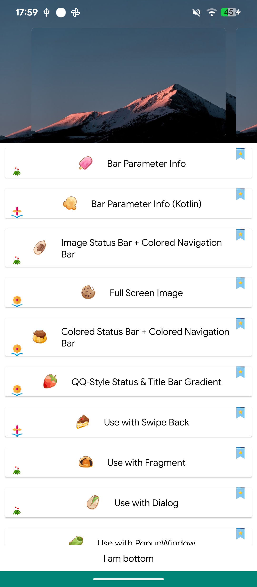
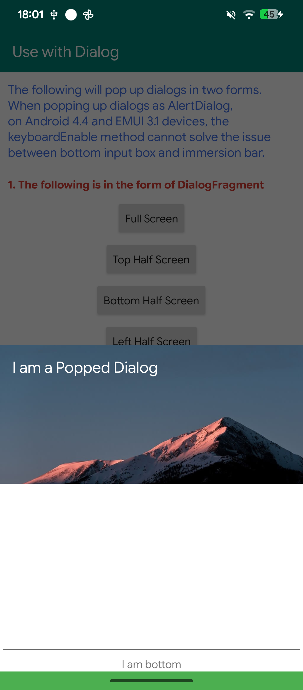
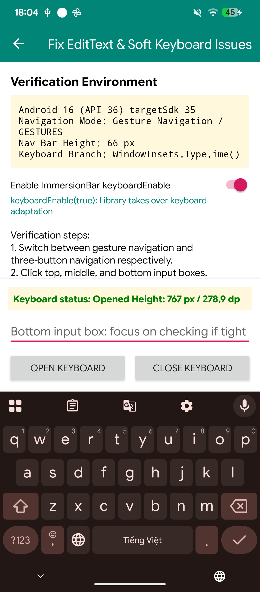
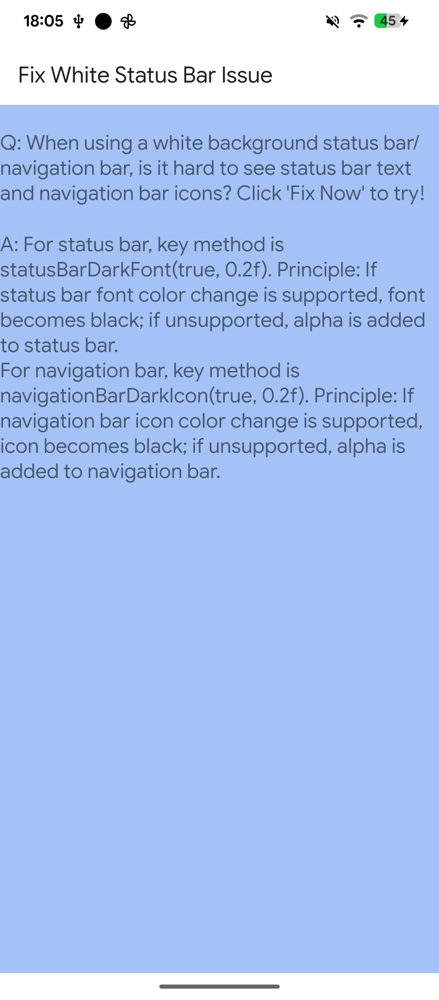
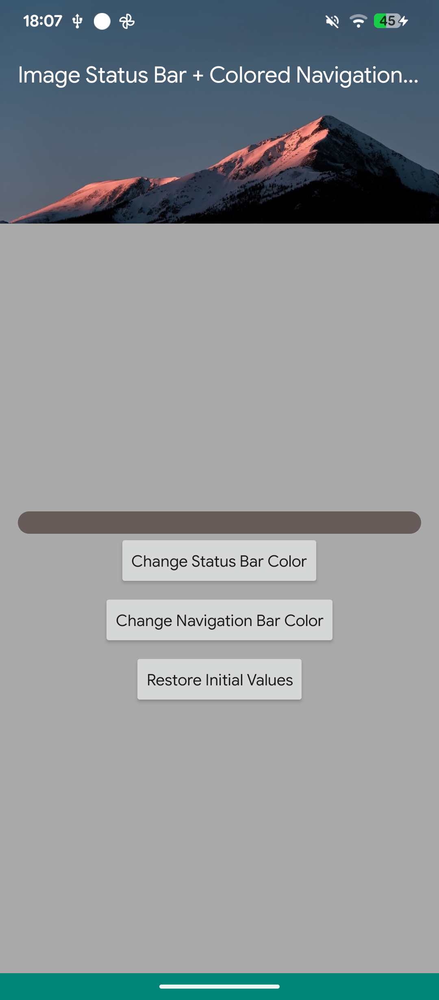
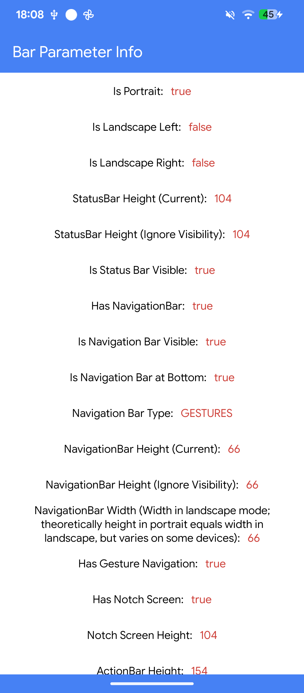

<p align="center">
  
</p>

# ImmersionBar -- Android 4.4+ Immersive System Bar Implementation
[](https://jitpack.io/#impeterwayne/ImmersionBar) [](http://www.apache.org/licenses/LICENSE-2.0.txt)

## Previews


## Dependency

### 1. Add the JitPack repository to your build file

Add it in your root `settings.gradle` at the end of repositories:

```groovy
dependencyResolutionManagement {
    repositoriesMode.set(RepositoriesMode.FAIL_ON_PROJECT_REPOS)
    repositories {
        google()
        mavenCentral()
        maven { url 'https://jitpack.io' }
    }
}
```

Or in your root `build.gradle` (legacy projects):

```groovy
allprojects {
    repositories {
        google()
        mavenCentral()
        maven { url 'https://jitpack.io' }
    }
}
```

### 2. Add dependency

In your app module `build.gradle`:

```groovy
dependencies {
    // Core library (includes Java core & Kotlin extensions)
    implementation 'com.github.impeterwayne:ImmersionBar:1.0.1'
}
```

Or in Kotlin DSL (`build.gradle.kts`):

```kotlin
dependencies {
    // Core library (includes Java core & Kotlin extensions)
    implementation("com.github.impeterwayne:ImmersionBar:1.0.1")
}
```

## Full-Screen and Display Cutout / Notch Adaptation
#### Full-Screen
Configure `AndroidManifest.xml` using one or more of the following:

① Set `targetSdkVersion` to 25 or above (standard on modern Android projects, rendering the other options unnecessary).

② Add to the `<application>` tag in `AndroidManifest.xml`:
```xml
android:resizeableActivity="true"
```
③ Add to the `<application>` tag in `AndroidManifest.xml`:
```xml
android:maxAspectRatio="2.4"
```
④ Add inside the `<application>` tag in `AndroidManifest.xml`:
```xml
<meta-data 
    android:name="android.max_aspect"
    android:value="2.4" />
```

#### Display Cutout / Notch Adaptation
Add inside the `<application>` tag in `AndroidManifest.xml`:
```xml
<!-- Huawei display cutout adaptation -->
<meta-data 
    android:name="android.notch_support" 
    android:value="true"/>
<!-- Xiaomi display cutout adaptation -->
<meta-data
    android:name="notch.config"
    android:value="portrait|landscape" />
```

## API Reference
- Basic Usage:
    ```java
    ImmersionBar.with(this).init();
    ```
- Advanced Usage (Parameter Details):
    ```java
    ImmersionBar.with(this)
                .transparentStatusBar()  // Transparent status bar (defaults to transparent)
                .transparentNavigationBar()  // Transparent navigation bar (defaults to black; calling this automatically sets fullScreen(true))
                .transparentBar()  // Transparent status bar and navigation bar (calling this automatically sets fullScreen(true))
                .statusBarColor(R.color.colorPrimary)  // Status bar color (defaults to transparent)
                .navigationBarColor(R.color.colorPrimary)  // Navigation bar color (defaults to black)
                .barColor(R.color.colorPrimary)  // Custom status and navigation bar colors simultaneously
                .statusBarAlpha(0.3f)  // Status bar alpha transparency (defaults to 0.0f)
                .navigationBarAlpha(0.4f)  // Navigation bar alpha transparency (defaults to 0.0f)
                .barAlpha(0.3f)  // Status and navigation bar alpha transparency (defaults to 0.0f)
                .statusBarDarkFont(true)  // Dark status bar font/icons (dark icons on light status bar)
                .navigationBarDarkIcon(true)  // Dark navigation bar icons (dark icons on light navigation bar)
                .autoDarkModeEnable(true)  // Automatically adapt status bar font and navigation bar icon color based on bar background colors
                .autoStatusBarDarkModeEnable(true, 0.2f)  // Automatically adapt status bar font color based on status bar color
                .autoNavigationBarDarkModeEnable(true, 0.2f)  // Automatically adapt navigation bar icon color based on navigation bar color
                .flymeOSStatusBarFontColor(R.color.btn3)  // Flyme OS status bar font color
                .fullScreen(true)  // Content extends behind navigation bar
                .hideBar(BarHide.FLAG_HIDE_BAR)  // Hide status bar, navigation bar, or both
                .addViewSupportTransformColor(toolbar)  // Add view that changes color alongside status bar
                .titleBar(view)  // Solves layout overlap by applying paddingTop (choose one overlap solution)
                .titleBarMarginTop(view)  // Solves layout overlap by applying marginTop (choose one overlap solution)
                .statusBarView(view)  // Solves layout overlap using a placeholder view (choose one overlap solution)
                .fitsSystemWindows(true)  // Solves layout overlap using fitsSystemWindows (must specify statusBarColor when true)
                .supportActionBar(true)  // Enables ActionBar support
                .statusBarColorTransform(R.color.orange)  // Status bar transformed color
                .navigationBarColorTransform(R.color.orange)  // Navigation bar transformed color
                .barColorTransform(R.color.orange)  // Status bar and navigation bar transformed color
                .removeSupportView(toolbar)  // Remove supported view
                .removeSupportAllView()  // Remove all supported views
                .navigationBarEnable(true)  // Whether navigation bar color modification is enabled (defaults to true)
                .navigationBarWithKitkatEnable(true)  // Enable navigation bar modification on Android 4.4 and EMUI 3.x
                .navigationBarWithEMUI3Enable(true)  // Enable navigation bar modification on EMUI 3.x
                .keyboardEnable(true)  // Solves layout conflict between soft keyboard and bottom input view (defaults to false)
                .keyboardMode(WindowManager.LayoutParams.SOFT_INPUT_ADJUST_RESIZE)  // Specify soft keyboard window mode
                .setOnKeyboardListener(new OnKeyboardListener() {  // Soft keyboard change callback (requires keyboardEnable(true))
                    @Override
                    public void onKeyboardChange(boolean isPopup, int keyboardHeight) {
                        LogUtils.e(isPopup);  // true if soft keyboard is shown, false if hidden
                    }
                })
                .addOnBarPropertiesChangedListener(onBarPropertiesChangedListener)  // Triggered on initialization, orientation change, and system bar visibility change to provide a BarProperties snapshot
                .addOnStatusBarChangedListener(onStatusBarChangedListener)  // Status bar listener, triggered on initialization, visibility change, and height change
                .addOnNavigationBarChangedListener(onNavigationBarChangedListener)  // Navigation bar listener, triggered on initialization, visibility, height, width, and navigation type change
                .addOnKeyboardChangedListener(onKeyboardChangedListener)  // Modern keyboard listener callback
                .addTag("tag")  // Tag configured parameters
                .getTag("tag")  // Retrieve configured parameters by tag
                .reset()  // Reset all immersion parameters
                .init();  // Apply configured parameters (must be called to take effect)
    ```

## Usage in Activity
- Java:
    ```java
    ImmersionBar.with(this).init();
    ```
- Kotlin:
    ```kotlin
    immersionBar {
        statusBarColor(R.color.colorPrimary) 
        navigationBarColor(R.color.colorPrimary)
    }
    ```

## Usage in Fragment
#### In Fragment:
- **Approach 1**: When used with `ViewPager2` and `BEHAVIOR_RESUME_ONLY_CURRENT_FRAGMENT`, configure immersion directly inside the Fragment's `onResume()`.
- **Approach 2**: When using `show()` and `hide()` to toggle Fragment visibility, configure immersion inside `onResume()` and `onHiddenChanged(boolean hidden)` (when `hidden == false`).

#### In Activity with Fragments:
- When using `ViewPager2`: listen for page changes via `registerOnPageChangeCallback`.
- When using `ViewPager`: listen for page changes via `addOnPageChangeListener` (see `FragmentThreeActivity` in sample).
- When using `show()` / `hide()`: update immersion when switching tabs (see `FragmentFourActivity` in sample).

#### With [Fragmentation](https://github.com/YoKeyword/Fragmentation):
- Refer to `FragmentFiveActivity` and `BaseFiveFragment` in the sample app.

## Usage in Dialog
- **With DialogFragment** (see `BaseDialogFragment` in sample):
    ```java
    ImmersionBar.with(this).init();
    ```
- **With standard Dialog** (from version 3.3.2+, automatically resolves Activity and auto-destroys on dismiss):
    ```java
    ImmersionBar.with(dialog).init();
    ```
    In Kotlin:
    ```kotlin
    dialog.immersionBar()
    ```



## Usage in PopupWindow
Call `setClippingEnabled(false)` on the PopupWindow to extend content behind system bars:
```java
popupWindow.setClippingEnabled(false);
```

## Resolving Status Bar and Top Layout Overlap (Choose One of Six Solutions)
- **① Custom dimension for status bar height** (not recommended as status bar height varies dynamically):
    In `values-v19/dimens.xml`:
    ```xml
    <dimen name="status_bar_height">25dp</dimen>
    ```
    In `values/dimens.xml`:
    ```xml
    <dimen name="status_bar_height">0dp</dimen>
    ```
    Add a placeholder View in your layout with height `@dimen/status_bar_height`:
    ```xml
    <LinearLayout xmlns:android="http://schemas.android.com/apk/res/android"
        xmlns:app="http://schemas.android.com/apk/res-auto"
        android:layout_width="match_parent"
        android:layout_height="match_parent"
        android:background="@color/darker_gray"
        android:orientation="vertical">

        <View
            android:layout_width="match_parent"
            android:layout_height="@dimen/status_bar_height"
            android:background="@color/colorPrimary" />

        <androidx.appcompat.widget.Toolbar
            android:layout_width="match_parent"
            android:layout_height="wrap_content"
            android:background="@color/colorPrimary"
            app:title="Method 1"
            app:titleTextColor="@android:color/white" />
    </LinearLayout>
    ```

- **② Android `fitsSystemWindows="true"` attribute** (avoids soft keyboard conflict; suitable for solid status bars; avoid in Fragments):
    ```xml
    <LinearLayout xmlns:android="http://schemas.android.com/apk/res/android"
        android:layout_width="match_parent"
        android:layout_height="match_parent"
        android:orientation="vertical"
        android:fitsSystemWindows="true">
    </LinearLayout>
    ```
    Must specify status bar color with ImmersionBar after layout is set:
    ```java
    ImmersionBar.with(this)
                .statusBarColor(R.color.colorPrimary)
                .init();
    ```

- **③ `fitsSystemWindows(boolean fits)` method** (suitable for solid status bars):
    ```java
    ImmersionBar.with(this)
                .fitsSystemWindows(true)
                .statusBarColor(R.color.colorPrimary)
                .init();
    ```

- **④ `statusBarView(View view)` method** (ideal for gradient status bars and swipe-to-back):
    Add a View above the title bar with height `0dp`:
    ```xml
    <View
        android:layout_width="match_parent"
        android:layout_height="0dp"
        android:background="@color/colorPrimary" />
    ```
    Then bind it with ImmersionBar:
    ```java
    ImmersionBar.with(this)
                .statusBarView(view)
                .init();
    ```

- **⑤ `titleBar(View view)` method** (adapts by applying paddingTop; title bar root cannot be RelativeLayout or ConstraintLayout):
    ```java
    ImmersionBar.with(this)
                .titleBar(view)
                .init();
    ```

- **⑥ `titleBarMarginTop(View view)` method** (adapts by applying marginTop; suitable for solid status bars):
    ```java
    ImmersionBar.with(this)
                .titleBarMarginTop(view)
                .statusBarColor(R.color.colorPrimary)
                .init();
    ```

## Handling EditText and Soft Keyboard Conflicts
- **Solution 1**:
    ```java
    ImmersionBar.with(this)
                .keyboardEnable(true)
                .init();
    ```
- **Solution 2**:
    Add `android:fitsSystemWindows="true"` to the root layout view (suitable for solid status bar colors).



## White Status Bar on Devices Without Dark Font Support
```java
ImmersionBar.with(this)
            .statusBarDarkFont(true, 0.2f)
            .init();
```
*Note: If the device supports status bar font color transformation, it sets font color to black; if unsupported, it adds a 20% alpha mask to preserve text readability.*



## System Bar Utility Methods
- `public static BarProperties getBarProperties(Activity activity)`:
  Returns a snapshot containing current status bar height, navigation bar height, visibility-ignored heights, navigation bar width, visibility, gesture navigation flag, position, type, display cutout info, and ActionBar height.
- `public static boolean hasNavigationBar(Activity activity)`:
  Checks whether a navigation bar is present.
- `public static int getNavigationBarHeight(Activity activity)`:
  Returns navigation bar height.
- `public static int getNavigationBarWidth(Activity activity)`:
  Returns navigation bar width.
- `public static boolean isNavigationAtBottom(Activity activity)`:
  Checks whether navigation bar is located at the bottom of the screen.
- `public static int getStatusBarHeight(Activity activity)`:
  Returns the physical height of the status bar.
- `public static int getActionBarHeight(Activity activity)`:
  Returns ActionBar height.
- `public static boolean hasNotchScreen(Activity activity)`:
  Checks whether the device has a display cutout / notch.
- `public static int getNotchHeight(Activity activity)`:
  Returns notch height synchronously.
- `public static void getNotchHeight(Activity activity, NotchCallback callback)`:
  Returns notch height asynchronously.
- `public static boolean isGesture(Activity activity)`:
  Checks whether full-screen gesture navigation is currently active.
- `public static boolean isSupportStatusBarDarkFont()`:
  Checks whether the device supports dark status bar icons/font.
- `public static boolean isSupportNavigationIconDark()`:
  Checks whether the device supports dark navigation bar icons.
- `public static void hideStatusBar(Window window)`:
  Hides the status bar.
- `public static void showStatusBar(Window window)`:
  Shows the status bar.

## ProGuard Rules (proguard-rules.pro)
No ProGuard rules are required. ImmersionBar includes bundled consumer ProGuard rules that are automatically applied to your build.

<details>
<summary>Manual rules (only required for legacy gyf-dev &lt;= 3.0.0 or if consumer rules are disabled)</summary>

```proguard
-keep class com.gyf.immersionbar.** {*;}
-dontwarn com.gyf.immersionbar.**
```
</details>

## FAQ
#### [Click here for FAQ](https://github.com/impeterwayne/ImmersionBar/wiki)

## Screenshots

| Main Demo Screen | Image Bar & Nav Bar | System Bar Properties |
| :---: | :---: | :---: |
|  |  |  |

| Dialog Immersion | Soft Keyboard Handling | White Status Bar (Dark Font) |
| :---: | :---: | :---: |
|  |  |  |

## Special Thanks
* Thanks to [zhangzhen92](https://github.com/zhangzhen92), [yutouxiansheng](https://github.com/yutouxiansheng), and [MrWhhh](https://github.com/MrWhhh) for testing and feedback.

## Contact
- QQ Group: 314360549
